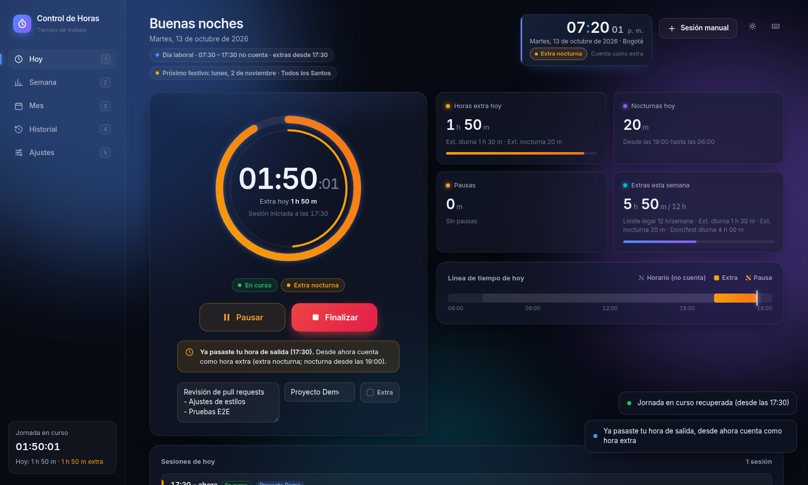
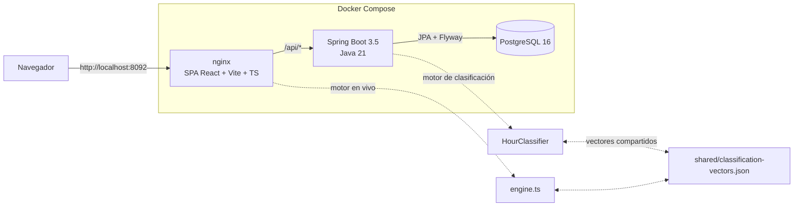
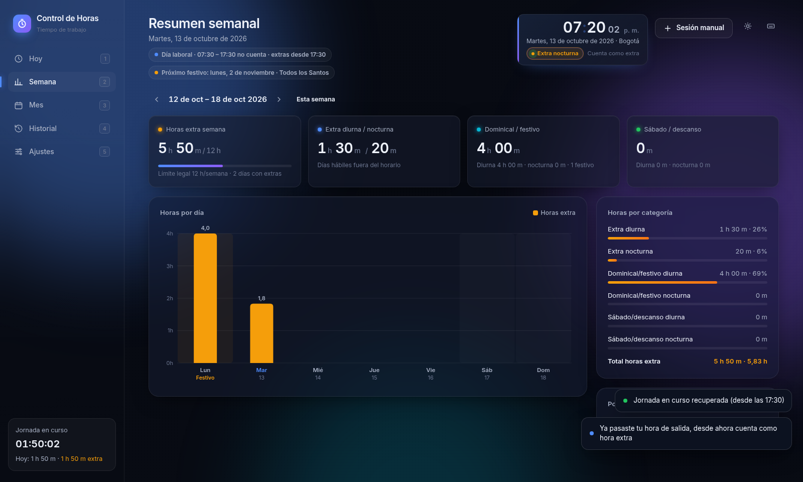
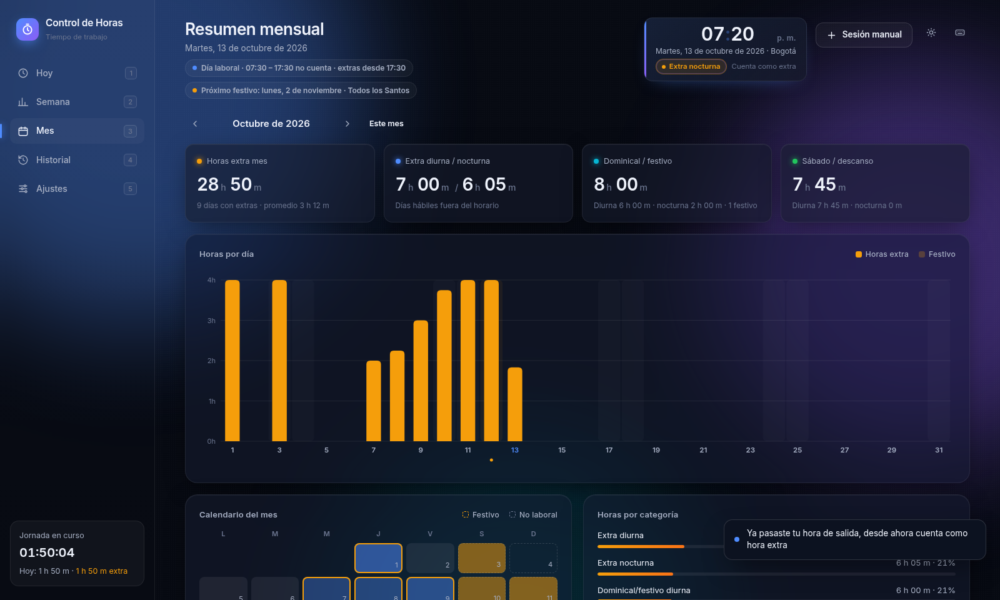
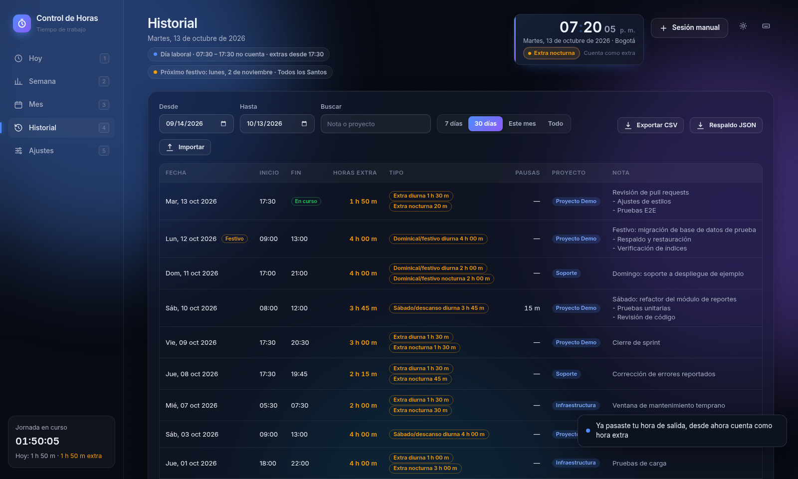
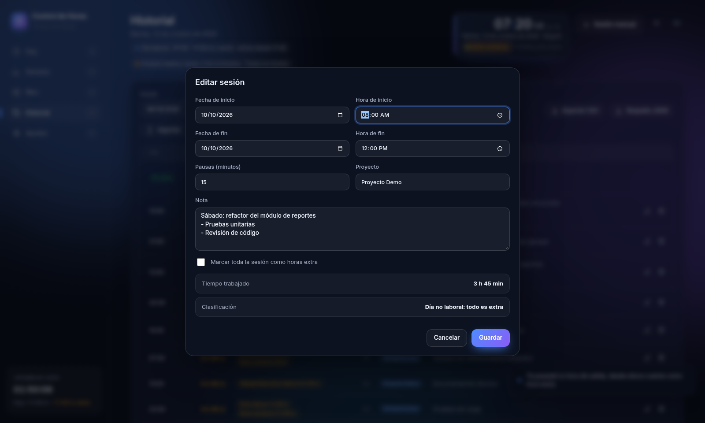
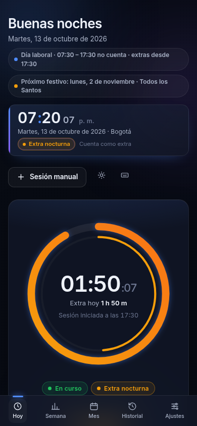

# ⏱️ Control de Horas Extra

[](https://github.com/JhonLaurens/control-horas/actions/workflows/ci.yml)


Aplicación web para **registrar horas extra** y clasificarlas automáticamente según las reglas laborales de **Colombia**: extra diurna/nocturna, dominical/festiva y de sábado o día de descanso. Solo cuenta **horas**; no calcula pagos ni recargos.

La idea es simple: inicias el cronómetro cuando empiezas a trabajar fuera de tu horario, lo finalizas al terminar, y la app reparte cada minuto en la categoría correcta, incluso si la sesión cruza la medianoche, cae en festivo o pasa la frontera de la jornada nocturna.



> Todas las capturas usan **datos de ejemplo**.

## ✨ Funcionalidades

- **Reloj en vivo** (hora de Bogotá) con la categoría vigente y la cuenta regresiva hasta que empiezan las horas extra.
- **Cronómetro** Iniciar / Pausar / Reanudar / Finalizar. La sesión en curso se guarda en PostgreSQL y sobrevive a recargas y reinicios.
- Anillo de progreso contra el **límite legal de 2 h extra/día**, con un anillo interior para el de **12 h/semana**, y una línea de tiempo del día.
- **Notas multilínea** (viñetas, saltos de línea; hasta 5000 caracteres) y proyecto por sesión.
- Vistas **Semana** y **Mes**: barras por día, calendario de calor, festivos del mes y desglose por categoría y por proyecto.
- **Historial** con filtros, búsqueda, edición, sesiones manuales y eliminación con *Deshacer*.
- **Exportación CSV** (compatible con Excel en español: `;`, coma decimal, BOM UTF-8) y **respaldo/importación JSON**.
- **Responsive**: escritorio ancho (hasta 1920 px y más), portátil y móvil (navegación inferior).
- Tema oscuro/claro, color de acento y atajos de teclado (`Espacio`, `P`, `N`, `1–5`, `?`).

## ⚖️ Reglas de clasificación

| Situación | Categoría |
|---|---|
| Día hábil (lun–vie, no festivo) **dentro del horario** (por defecto 07:30–17:30) | **No cuenta.** La app solo registra horas extra |
| Día hábil, antes de la entrada o después de la salida | Extra diurna / Extra nocturna |
| Domingo o festivo (todo el día) | Dominical/festivo diurna / nocturna |
| Sábado o día no laboral (todo el día) | Sábado/descanso diurna / nocturna |

- **Jornada nocturna:** desde el **25 de diciembre de 2025** va de **19:00 a 06:00** (Ley 2466 de 2025, que modifica el art. 160 del CST). Antes de esa fecha se aplica **21:00 a 06:00** (Ley 1846 de 2017). La frontera se aplica según la fecha de cada día.
- **Festivos de Colombia** calculados para cualquier año: fechas fijas, traslados al lunes (**Ley Emiliani**, Ley 51 de 1983) y festivos basados en la Pascua.
- Las sesiones que cruzan la medianoche se dividen por día calendario, así que un domingo o festivo solo afecta sus propias horas.
- Si inicias una sesión dentro del horario laboral, la app te avisa y la sesión cuenta 0 hasta la hora de salida. Las sesiones marcadas manualmente como *Extra* cuentan completas.
- Horario, días laborales e inicio/fin nocturno se pueden ajustar en **Ajustes**.

El mismo algoritmo vive en el backend (`HourClassifier.java`, fuente de verdad de resúmenes y CSV) y en el frontend (`engine.ts`, cronómetro en vivo). Ambos se validan contra los **mismos casos de prueba**: [`shared/classification-vectors.json`](shared/classification-vectors.json).

## 🏗️ Arquitectura



| Capa | Tecnología |
|---|---|
| Frontend | React 18, Vite 6, TypeScript, CSS propio (estilo Fluent), Vitest |
| Backend | Spring Boot 3.5, Java 21, Spring Data JPA, Flyway, Bean Validation, Actuator, JUnit 5 |
| Base de datos | PostgreSQL 16 |
| Infraestructura | Docker Compose, nginx, GitHub Actions |

## 🚀 Inicio rápido (Docker)

Requisitos: Docker Desktop o Docker Engine con Compose v2.

```bash
git clone https://github.com/JhonLaurens/control-horas.git
cd control-horas
cp .env.example .env          # en Windows: copy .env.example .env
# edita .env y define una contraseña propia en POSTGRES_PASSWORD
docker compose up -d --build
docker compose ps             # los 3 servicios deben quedar "healthy"
```

| Servicio | URL | Notas |
|---|---|---|
| Interfaz web | http://localhost:8092 | nginx sirve la SPA y redirige `/api` al backend |
| API REST | http://localhost:8093/api | Acceso directo opcional al backend |
| Salud | http://localhost:8092/api/health | `{"status":"UP"}` |

Los puertos solo escuchan en `127.0.0.1`. Si están ocupados, cámbialos en `.env` (`FRONTEND_PORT`, `BACKEND_PORT`).

```bash
docker compose stop            # detener (los datos se conservan)
docker compose up -d --build   # actualizar tras cambiar el código
docker compose logs -f backend # ver logs
```

> ⚠️ `docker compose down -v` **borra el volumen** con todos los datos. Usa `docker compose down` (sin `-v`) para conservarlos.

**Respaldo de la base de datos:**

```bash
docker compose exec -T db pg_dump -U controlhoras controlhoras > respaldo.sql
```

También puedes descargar un respaldo JSON desde **Historial → Respaldo JSON**.

## 🧪 Pruebas

```bash
cd backend  && mvn test                     # JUnit: festivos, clasificador (vectores compartidos), CSV
cd frontend && npm ci && npm test           # Vitest: motor TypeScript con los mismos vectores
cd frontend && npm run build                # type-check + build de producción
```

La prueba de humo E2E (`e2e/`, Playwright) recorre la app contra una instancia real y **borra sus datos**: úsala solo contra una base de pruebas.

GitHub Actions ejecuta las pruebas del backend y del frontend en cada push y pull request ([`ci.yml`](.github/workflows/ci.yml)).

## 💻 Desarrollo local (sin Docker)

```bash
# 1) PostgreSQL local con base/usuario "controlhoras" (o ajusta DB_URL, DB_USER, DB_PASSWORD)
cd backend && mvn spring-boot:run           # API en :8080
cd frontend && npm install && npm run dev   # UI en :5173 con proxy /api -> :8080
```

## 🔌 API REST (resumen)

Los instantes viajan como milisegundos desde epoch. Los errores usan `ProblemDetail` (RFC 9457).

| Método | Ruta | Descripción |
|---|---|---|
| GET | `/api/state` | Sesiones, sesión activa y ajustes |
| POST | `/api/active/start` · `/pause` · `/resume` · `/stop` | Control de la sesión en curso |
| PATCH | `/api/active` | Nota, proyecto o marca *extra* de la sesión en curso |
| GET/POST | `/api/sessions` | Listar / crear sesión manual |
| PUT/DELETE | `/api/sessions/{id}` | Editar / eliminar |
| GET/PUT | `/api/settings` | Ajustes |
| GET | `/api/summary/day` · `/week` · `/month` · `/range` | Resúmenes por categoría |
| GET | `/api/holidays?year=` | Festivos de Colombia |
| GET | `/api/export/csv` · `/api/export/json` | Exportar |
| POST | `/api/import` | Importar respaldo JSON |
| GET | `/api/health` | Salud (Actuator) |

## 📁 Estructura

```
backend/            Spring Boot (engine/, domain/, repo/, service/, web/, db/migration/)
frontend/           React + Vite (lib/engine.ts, views/, components/, nginx.conf)
shared/             Casos de prueba de clasificación compartidos backend/frontend
e2e/                Prueba de humo de extremo a extremo (Playwright)
legacy/             Versión original en un solo archivo HTML (funciona sin conexión)
docs/screenshots/   Capturas con datos de ejemplo
.github/workflows/  Integración continua
```

## 📸 Capturas

| Semana | Mes |
|---|---|
|  |  |

| Historial con notas multilínea | Editar sesión |
|---|---|
|  |  |

<p align="center"></p>

## ⚠️ Aviso

Esta herramienta es un proyecto personal de código abierto para **llevar la cuenta de horas**. **No constituye asesoría legal ni laboral**, y no reemplaza la liquidación oficial de un empleador. Las reglas implementadas reflejan la interpretación del autor de la normativa vigente a 2026; verifica siempre con la fuente oficial o un profesional.

## 📄 Licencia

[MIT](LICENSE) © 2026 JhonLaurens
