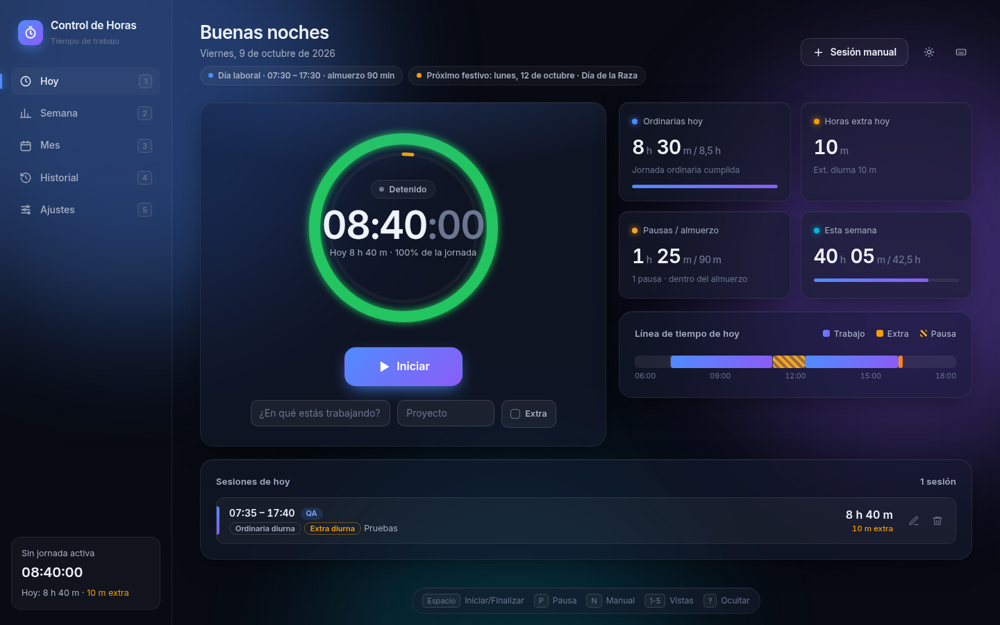

# Control de Horas

Aplicación personal para registrar la jornada laboral (inicio, pausas y fin) y clasificar **automáticamente** cada minuto según las reglas colombianas de jornada **diurna / nocturna**, **horas extra**, **dominicales y festivos** y **sábados / días de descanso**. Solo cuenta **horas**: no calcula pagos ni recargos.

- **Frontend:** React 18 + Vite + TypeScript (servido por nginx)
- **Backend:** Spring Boot 3.5 + Java 21 (API REST, Spring Data JPA, Flyway, Bean Validation, Actuator)
- **Base de datos:** PostgreSQL 16
- **Despliegue:** Docker Compose (local, un solo usuario, sin autenticación, puertos solo en `127.0.0.1`)



## Funcionalidades

- Cronómetro en vivo con **Iniciar / Pausar / Reanudar / Finalizar**. La jornada en curso queda guardada en PostgreSQL: sobrevive a recargas, cierres del navegador y reinicios del PC.
- Anillo de progreso hacia la jornada ordinaria del día, KPIs (ordinarias, extra, pausas/almuerzo y semana), línea de tiempo del día y avisos al pasar la hora de salida o completar la jornada.
- Vistas **Semana** y **Mes** con barras ordinarias + extra, meta diaria, calendario de calor, festivos del mes y desglose **por categoría** y **por proyecto**.
- **Historial** con filtros, edición, eliminación (con *Deshacer*), exportación **CSV** (Excel en español: `;`, coma decimal, BOM) y **respaldo JSON**.
- **Importación del respaldo JSON de la versión HTML** (`legacy/ControlHoras.html`): botón *Importar* en Historial. Las sesiones repetidas o inválidas se omiten, así que reimportar no duplica datos.
- Ajustes: horario (por defecto 07:30 – 17:30, lunes a viernes), almuerzo no remunerado (90 min, editable a 0), inicio/fin de la jornada nocturna, tema claro/oscuro y color de acento.
- Atajos: `Espacio` iniciar/finalizar · `P` pausa · `X` marcar extra · `N` sesión manual · `T` tema · `1–5` vistas · `?` barra de atajos.

## Reglas de clasificación

| Categoría | Cuándo aplica |
|---|---|
| Ordinaria diurna / nocturna | Día laboral, dentro del horario, hasta completar la jornada (horario − almuerzo; por defecto 8 h 30 m) |
| Extra diurna / nocturna | Día laboral: antes de la entrada, después de la salida, lo que excede la jornada o sesiones marcadas como *Extra* |
| Dominical/festivo diurna / nocturna | Todo lo trabajado en domingo o festivo |
| Sábado/descanso diurna / nocturna | Todo lo trabajado en sábado o en un día no marcado como laboral |

- **Jornada nocturna (CST art. 160):** desde el **25 de diciembre de 2025** va de **19:00 a 06:00** (Ley 2466 de 2025). Antes de esa fecha se aplica **21:00 a 06:00** (Ley 1846 de 2017). La frontera se aplica según la fecha de cada día y se puede personalizar en Ajustes.
- Las sesiones que cruzan la medianoche se dividen por día calendario. Así, un festivo o domingo solo afecta sus propias horas.
- **Festivos de Colombia** calculados para cualquier año: fijos, Ley Emiliani (traslado al lunes) y los basados en la Pascua.
- La meta semanal se reduce automáticamente cuando la semana tiene festivos.

El mismo algoritmo existe en el backend (`HourClassifier.java`, fuente de verdad para resúmenes y CSV) y en el frontend (`engine.ts`, para el cronómetro en vivo). Ambos se validan con los **mismos casos de prueba**: `shared/classification-vectors.json`.

## Puesta en marcha con Docker (Windows, macOS o Linux)

Requisitos: Docker Desktop / Docker Engine con Compose v2.

```powershell
cd C:\innovacion\control-horas
copy .env.example .env        # luego edita .env y cambia POSTGRES_PASSWORD
docker compose up -d --build
docker compose ps             # los 3 servicios deben quedar "healthy"
```

Abre **http://localhost:8092**.

| Servicio | URL local | Notas |
|---|---|---|
| Interfaz web | http://localhost:8092 | nginx sirve la SPA y redirige `/api` al backend |
| API REST | http://localhost:8093/api | Acceso directo opcional al backend |
| Salud | http://localhost:8092/api/health | `{"status":"UP"}` |

Si un puerto está ocupado, cámbialo en `.env` (`FRONTEND_PORT`, `BACKEND_PORT`). En este PC el 8090 lo usa Windows (HTTP.sys), por eso se usan 8092/8093.

El primer `build` descarga dependencias y ejecuta las pruebas unitarias (backend y frontend). Para compilar más rápido define `SKIP_TESTS=true` en `.env`.

### Operación diaria

```powershell
docker compose stop                 # detener (los datos se conservan)
docker compose start                # volver a iniciar
docker compose logs -f backend      # ver logs
docker compose up -d --build        # actualizar tras cambiar el código
```

Los contenedores usan `restart: unless-stopped`: arrancan solos con Docker Desktop.

### Respaldo y restauración de la base de datos

```powershell
# Respaldo (archivo SQL)
docker compose exec -T db pg_dump -U controlhoras controlhoras > respaldo.sql
# Restauración
Get-Content respaldo.sql | docker compose exec -T db psql -U controlhoras controlhoras
```

También puedes descargar el respaldo JSON desde **Historial → Respaldo JSON** e importarlo después.

> ⚠️ `docker compose down -v` **borra el volumen** con todos los datos. Usa `docker compose down` (sin `-v`) para conservarlos.

## Desarrollo local (sin Docker)

```bash
# 1) PostgreSQL local con base/usuario "controlhoras" (o ajusta DB_URL, DB_USER, DB_PASSWORD)
# 2) Backend (puerto 8080)
cd backend && mvn spring-boot:run
# 3) Frontend (puerto 5173, con proxy /api -> 8080)
cd frontend && npm install && npm run dev
```

### Pruebas

```bash
cd backend && mvn test          # JUnit: festivos, clasificador (vectores compartidos), validaciones
cd frontend && npm test         # Vitest: motor TypeScript con los mismos vectores
cd e2e && npm install && APP_URL=http://localhost:8092 HTML_APP=$PWD/../legacy/ControlHoras.html node e2e.cjs
```

> La prueba E2E **borra los datos** de la instancia indicada. Úsala solo contra una base de pruebas.

## API REST (resumen)

Los instantes viajan como milisegundos desde epoch. Los errores usan `ProblemDetail` (RFC 9457) con mensajes en español.

| Método | Ruta | Descripción |
|---|---|---|
| GET | `/api/state` | Sesiones terminadas, jornada activa y ajustes |
| POST | `/api/active/start` · `/pause` · `/resume` · `/stop` | Control de la jornada en curso (409 si no aplica) |
| PATCH | `/api/active` | Nota, proyecto o marca *extra* de la jornada en curso |
| GET/POST | `/api/sessions` | Listar / crear sesión manual |
| PUT/DELETE | `/api/sessions/{id}` | Editar / eliminar |
| GET/PUT | `/api/settings` | Ajustes |
| GET | `/api/summary/day?date=` · `/week?date=` · `/month?year=&month=` · `/range?from=&to=` | Resúmenes con las 8 categorías |
| GET | `/api/holidays?year=` | Festivos de Colombia |
| GET | `/api/export/csv?from=&to=&q=` · `/api/export/json` | Exportar |
| POST | `/api/import` | Importar respaldo JSON (versión HTML o esta app) |
| DELETE | `/api/data` | Borrar todo |
| GET | `/api/health` | Salud (Actuator) |

## Estructura

```
backend/    Spring Boot (engine/, domain/, repo/, service/, web/, db/migration/)
frontend/   React + Vite (lib/engine.ts, views/, components/, nginx.conf)
shared/     Casos de prueba de clasificación compartidos
e2e/        Prueba de humo de extremo a extremo (Playwright)
legacy/     Versión original en un solo archivo HTML (sin conexión)
docs/       Capturas
```

## Licencia

Proyecto personal. Uso privado.
